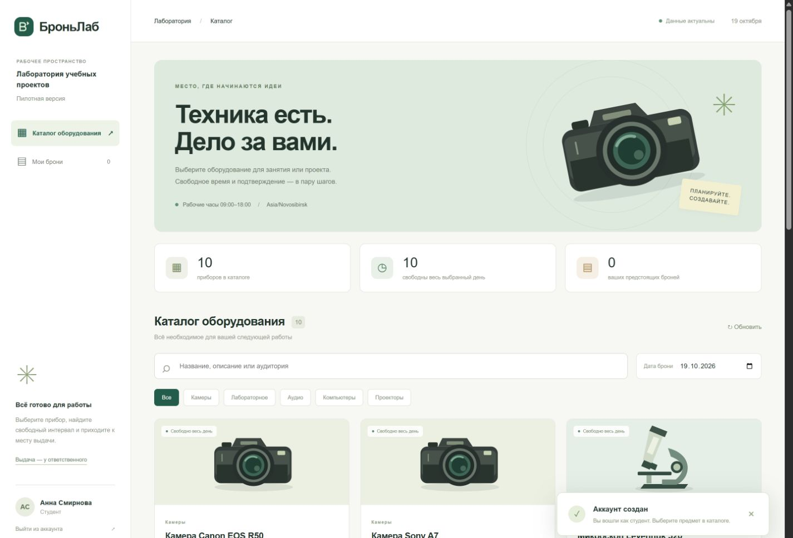

# БроньЛаб

Оборудование для учебных проектов — каталог, свободное время и бронирование в одном месте.

### [Открыть приложение](https://185.153.183.233:8443/)

### [Инструкция пользователя](docs/USER_MANUAL.md) · [Инструкция на сайте](https://185.153.183.233:8443/help)

[Исходный код на GitHub](https://github.com/Pozdnyakov-Artem/Bron-_lab)

БроньЛаб помогает студентам и сотрудникам лаборатории НГУ найти общий прибор, узнать, где его получить, и забронировать свободный интервал. Работает в браузере компьютера и телефона; данные общие и сохраняются на сервере.



## Тестовые аккаунты на сервере

Эти аккаунты работают на [опубликованном сайте](https://185.153.183.233:8443/) и предназначены для демонстрации ролей:

| Роль | Логин | Пароль |
|---|---|---|
| Преподаватель | `teacher-demo` | `TeacherDemo2026!` |
| Администратор | `admin-demo` | `AdminDemo2026!` |

Преподаватель может смотреть каталог и бронировать оборудование. Администратор дополнительно видит кнопку «+ Добавить предмет». Аккаунты общие: созданные через них карточки и брони видны другим пользователям сайта. Для собственных броней зарегистрируйте личный аккаунт.

## Подтверждение статуса преподавателя и получение роли администратора

В данный момент для **подтверждения статуса преподавателя** или **запроса на предоставление роли администратора** нужно отправить письмо на **[a.pozdnyakov1@g.nsu.ru](mailto:a.pozdnyakov1@g.nsu.ru)**. Укажите свой логин или университетскую почту и нужную роль. Самостоятельная регистрация создаёт только студенческий аккаунт; изменение роли выполняется вручную после рассмотрения запроса.

**Если у вас нет почты НГУ `@g.nsu.ru`,** также напишите на **[a.pozdnyakov1@g.nsu.ru](mailto:a.pozdnyakov1@g.nsu.ru)** и приложите подтверждающий документ. После проверки документа владелец проекта выдаст вам аккаунт для входа на сайт.

## Как проверить за несколько минут

1. Откройте [сайт](https://185.153.183.233:8443/).
2. Выберите «Регистрация»: имя, собственная почта `@g.nsu.ru`, пароль от 10 символов, повтор пароля → «Зарегистрироваться». Получите роль студента. Письмо-подтверждение не отправляется: в пилоте проверяется только домен.
3. В каталоге найдите «Sony», выберите дату → «Забронировать».
4. Выберите свободное время в пределах 09:00–18:00 → «Подтвердить бронь». При совпадении с чужой бронью заявка будет отклонена.
5. Откройте «Мои брони»: проверьте предмет, время и место получения. Перезагрузите страницу — запись останется.
6. Для проверки администратора войдите как `admin-demo` по паролю из таблицы выше → «+ Добавить предмет» → название, место получения, категория и описание → «Добавить в каталог». Карточка сразу доступна другим пользователям.

Личные серверные пароли переданы владельцу отдельно и отличаются от публичных тестовых аккаунтов. Существующие логины администратора и преподавателя сохраняются. Самостоятельная регистрация привилегированных ролей запрещена.

## Функции

| Задача | Что реализовано |
|---|---|
| Каталог | Карточки с описанием и местом выдачи, поиск и категории, скрытые приборы не отображаются |
| Занятость | Расписание по прибору и дате, свободные интервалы, обновление каждые 15 секунд |
| Бронирование | Только ещё не начавшиеся интервалы по новосибирскому времени (UTC+7), сегодня и будущие дни, рабочие часы, проверка пересечений и сохранение в одной транзакции, защита от дубликатов |
| Создание предметов | Только администратор; форма прямо в каталоге, собственные категории, до 30 предметов |
| Регистрация НГУ | Только точный домен @g.nsu.ru, уникальная почта, пароль с хешированием, роль студента |
| Личный кабинет | Свои брони, дата, время и место получения |
| CLI | validate, run, dry-run, каталог и занятость; пакетные операции из YAML |

В этой версии нет SSO НГУ, подтверждения владения почтой, отправки писем, самостоятельного сброса пароля, редактирования/удаления карточек, отмены брони, оплаты и учёта физической выдачи. Такие действия при необходимости выполняет ответственный оператор. Роль преподавателя даёт те же действия бронирования, что и роль студента; администратор дополнительно создаёт предметы.

## Архитектура

Адаптивный HTML/CSS/JavaScript → Flask REST API → правила приложения → SQLite. Nginx принимает HTTPS, Waitress выполняет Python-приложение. Сервер запускается через systemd; ежедневные копии SQLite и автоматическое продление TLS настроены.

| Файл | Назначение |
|---|---|
| `bronylab/config.py` | Загрузка и проверка YAML до доступа к данным |
| `bronylab/repository.py` | SQLite, миграция, аккаунты и каталог, транзакции |
| `bronylab/validation.py` | Домен регистрации, пароль и поля новых карточек |
| `bronylab/service.py` | Правила бронирования, planner/executor, dry-run и аудит |
| `bronylab/web.py` | REST, сессии, проверка роли, CSRF, лимиты входа/регистрации |
| `bronylab/cli.py` | Команды оператора и сервер Waitress |
| `bronylab/templates/`, `bronylab/static/` | Веб-интерфейс, формы и встроенная инструкция |
| `tests/` | Автоматическая проверка правил, API, миграции и конкурентных запросов |

Новые аккаунты и карточки, созданные через сайт, имеют источник `web`. Начальные справочники имеют источник `config`; их синхронизация не стирает записи `web`. История броней и пароли старых аккаунтов сохраняются при миграции версии 0.2.0.

## Локальный запуск

На Windows распакуйте проект и откройте **`start.cmd`**. Нужен Python 3.11+ и интернет для первой установки зависимостей. Скрипт создаёт виртуальное окружение; сайт доступен на `http://127.0.0.1:8000`.

Обычная установка:

```bash
python -m venv .venv
# Windows: .venv\Scripts\activate
# Linux/macOS: source .venv/bin/activate
python -m pip install -e ".[test]"
bronylab validate --config config.yaml
bronylab serve --config config.yaml
```

Только для локальной демонстрации:

| Роль | Логин | Пароль |
|---|---|---|
| Студент | student-01 | StudentLab2026! |
| Преподаватель | teacher-01 | TeacherLab2026! |
| Администратор | admin-01 | AdminLab2026! |

На публичном сервере эти пароли **не действуют**. Пользователи также могут создать студенческий аккаунт через форму регистрации.

## Проверки

```bash
python -m pip install -e ".[test]"
python -m pytest -q
bronylab run --config examples/batch.yaml --dry-run
```

117 тестов проверяют бронирование, запрет прошедших дат и времени, границы минут, новосибирское время и смену суток, транзакционные конфликты, dry-run, валидацию YAML, регистрацию и точный домен, уникальность почты, авторизацию, невозможность повышения роли, добавление предметов только администратором, лимит каталога, перенос старой базы и сохранение новых записей после повторного запуска. Руководство и все его изображения также проверяются тестами.

## Документация

- [Бизнес-гипотеза «БроньЛаб» — исходный PDF](docs/Бизнес-гипотеза_БроньЛаб.pdf).
- [Архитектура и техническое задание, этап 2 — исходный PDF](docs/этап2.md.pdf).
- [Пользовательское руководство: сценарии, скриншоты, ошибки, FAQ](docs/USER_MANUAL.md).
- [Техническое руководство: установка, YAML, CLI, API и безопасность](docs/TECHNICAL_GUIDE.md).
- [Управление размещённым сервером и резервными копиями](DEPLOYMENT.md).
- [Соответствие требованиям и результаты приёмки](ACCEPTANCE.md).

README и пользовательская инструкция оформлены по структуре [примера RoomSplit](https://github.com/puoku/roomsplit/blob/main/docs/USER_MANUAL.md). Реализация и описанные сценарии относятся к БроньЛаб. Публичный репозиторий RoomSplit не изменялся. Исходники БроньЛаб находятся в этом репозитории и передаются отдельным архивом.
