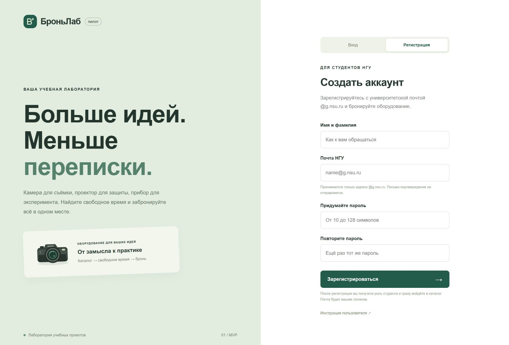
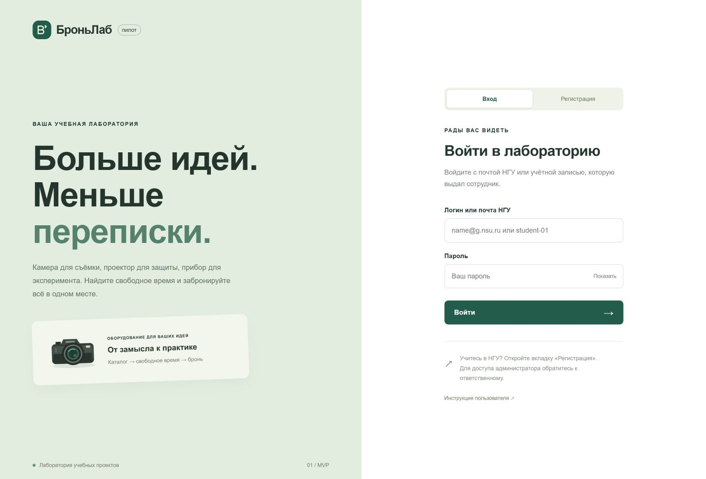
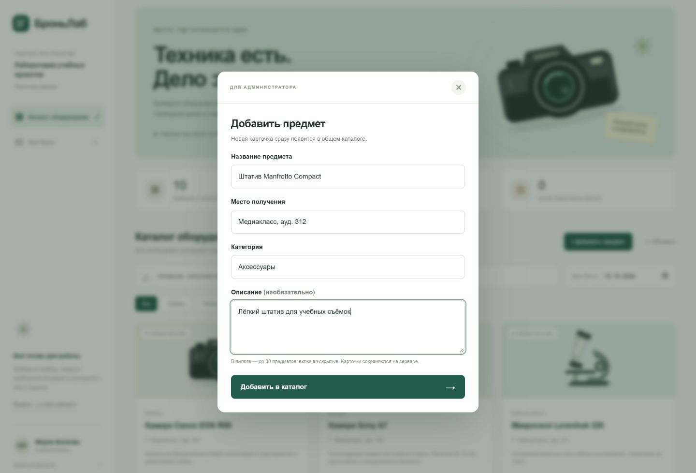
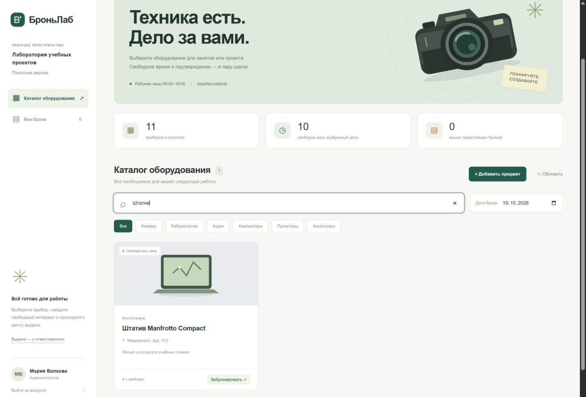
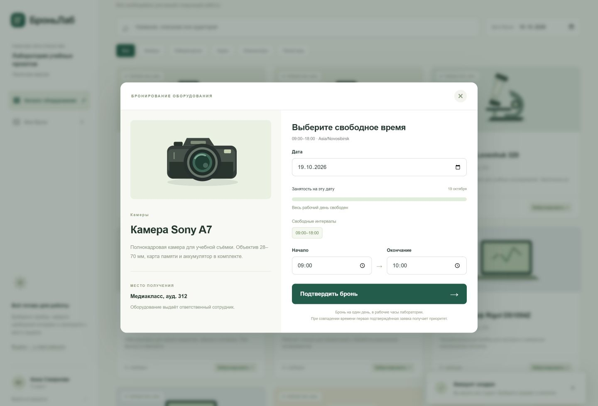
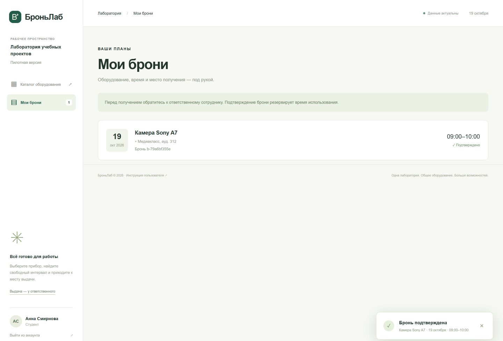
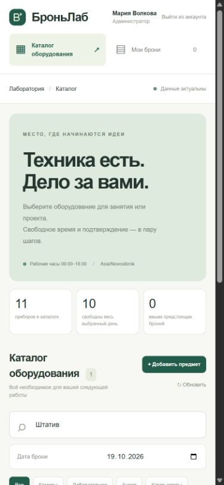
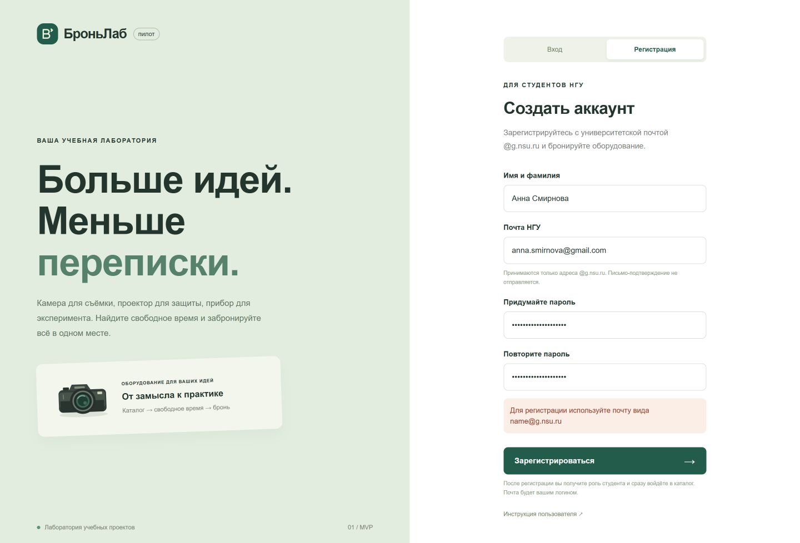

# ИНСТРУКЦИЯ ПОЛЬЗОВАТЕЛЯ БроньЛаб (пошаговое руководство)

## 0. ВВЕДЕНИЕ

- **Название проекта:** БроньЛаб — общее оборудование для учебных проектов.
- **Работающий сайт:** [https://185.153.183.233:8443/](https://185.153.183.233:8443/). Устанавливать приложение не нужно.
- **Исходный код:** [Pozdnyakov-Artem/Bron-_lab](https://github.com/Pozdnyakov-Artem/Bron-_lab). Также проект передаётся архивом `bronylab-project.zip`.
- **Для кого:** для студентов и сотрудников лаборатории НГУ; администратор ведёт каталог.
- **Что можно сделать:** найти предмет и место его получения, посмотреть занятые интервалы, забронировать свободное время. Администратор также добавляет предметы.
- **Время знакомства:** ориентировочно 2–3 минуты до первой брони, если аккаунт уже есть. Это ориентир для знакомства, а не результат пользовательского исследования.

---

## 1. ПЕРВЫЙ ВХОД В ПРОДУКТ

Откройте [сайт БроньЛаб](https://185.153.183.233:8443/) на компьютере или телефоне. Не убирайте `:8443` из адреса — на сервере этот порт выделен для сайта.

### Если аккаунта ещё нет

1. На экране входа выберите **«Регистрация»**.
2. Введите **имя и фамилию**.
3. Укажите свою **почту НГУ** с окончанием `@g.nsu.ru`.
4. Придумайте пароль длиной **от 10 до 128 символов** и повторите его.
5. Нажмите **«Зарегистрироваться»**.
6. Откроется каталог. В профиле появится ваше имя и роль **«Студент»**.

**Пример:** Анна Смирнова, `anna.smirnova@g.nsu.ru`, свой новый пароль. Адрес в примере вымышленный — используйте собственную почту.

Разрешён только точный домен `@g.nsu.ru`. Адреса `@nsu.ru`, `@gmail.com` и `@g.nsu.ru.example.com` не подходят. Пробелы по краям удаляются; регистр букв почты не имеет значения.

> В этой версии проверяется формат и домен адреса. Письмо или код подтверждения не отправляется, поэтому владение почтовым ящиком не подтверждается. Это согласованное ограничение пилота, а не вход через университетскую систему.

### Если аккаунт уже есть

1. Выберите **«Вход»**.
2. В поле **«Логин или почта НГУ»** введите почту, использованную при регистрации, либо выданный логин, например `student-01`.
3. Введите пароль и нажмите **«Войти»**.

Администратор и преподаватель используют выданные аккаунты. Самостоятельно выбрать или повысить роль при регистрации нельзя. Пароли серверных аккаунтов переданы владельцу отдельно и не публикуются в руководстве.

### Разница между ролями

| Действие | Студент | Преподаватель | Администратор |
|---|---|---|---|
| Просмотреть каталог и занятость | Да | Да | Да |
| Забронировать предмет от своего имени | Да | Да | Да |
| Посмотреть свои брони | Да | Да | Да |
| Добавить предмет в каталог | Нет | Нет | Да |

> Аккаунты, карточки и брони хранятся на сервере. Обновление страницы, выход из аккаунта и перезапуск сервера не стирают их.

---

## 2. ОСНОВНАЯ ФУНКЦИЯ №1: КАТАЛОГ И ДОБАВЛЕНИЕ ПРЕДМЕТОВ

**Назначение:** выбрать подходящий предмет по характеристикам и заранее узнать, где его получить.

### Поиск оборудования

1. Откройте **«Каталог оборудования»**.
2. Введите в поиск название, часть описания или аудиторию: например, **Sony** или **312**.
3. При необходимости выберите категорию: например, **«Камеры»**.
4. Установите **дату брони**. Метки доступности и число свободных часов относятся к этой дате.
5. На карточке посмотрите название, описание и место получения.
6. Для точного расписания нажмите **«Забронировать»**.

**Результат:** вы нашли «Камера Sony A7», увидели место получения «Медиакласс, ауд. 312» и открыли её расписание. Пометка «Есть занятые интервалы» означает, что часть дня занята; свободное время всё ещё может быть доступно.

### Добавление предмета администратором

1. Войдите с аккаунтом администратора.
2. В каталоге нажмите **«+ Добавить предмет»**.
3. Введите **название предмета**, **место получения** и **категорию**. Категорию можно выбрать из подсказки или написать новую.
4. При желании заполните **описание**: характеристики, комплектность и условия получения.
5. Нажмите **«Добавить в каталог»**.
6. Закроется форма, появится сообщение **«Предмет добавлен»**. Новую карточку сразу смогут увидеть все пользователи.

**Пример ввода:** «Штатив Manfrotto Compact», «Медиакласс, ауд. 312», «Аксессуары», «Лёгкий штатив для учебных съёмок».

**Результат:** в каталоге появилась отдельная карточка штатива и категория «Аксессуары». Предмет можно бронировать без перезапуска сервера.

| Форма администратора | Результат добавления |
|---|---|
|  |  |

Название и место получения — до 150 символов каждое, категория — до 80, описание — до 2000. В пилоте хранится не более **30 предметов, включая скрытые**. Одинаковые названия допустимы для разных физических единиц; уточняйте инвентарный номер в названии. Редактирование и удаление через сайт пока не предусмотрены: ошибочную карточку исправляет оператор сервера.

---

## 3. ОСНОВНАЯ ФУНКЦИЯ №2: ЗАНЯТОСТЬ И БРОНИРОВАНИЕ

**Назначение:** зарезервировать оборудование на подходящий интервал и избежать накладок.

1. Нажмите **«Забронировать»** на нужной карточке.
2. Выберите **дату**. Форма покажет занятые и свободные интервалы.
3. Нажмите подходящий свободный интервал — в поля подставится его начало и длительность до одного часа. При необходимости измените время вручную.
4. Проверьте поля **«Начало»** и **«Окончание»**.
5. Нажмите **«Подтвердить бронь»**.
6. Появится сообщение **«Бронь подтверждена»**, а расписание обновится.

**Пример:** камера Sony A7, 20 октября 2026 года, 10:00–11:00. Если интервал свободен, бронь сохранится за вашим аккаунтом. Это пример — свободные интервалы на реальном сайте зависят от текущих заявок.

- Рабочие часы в текущем пилоте — **09:00–18:00, Asia/Novosibirsk**. Они также указаны на сайте.
- Рядом с расписанием показывается **текущее новосибирское время (UTC+7)**. Сегодня доступны только интервалы, которые ещё не начались. Например, в 12:00 нельзя создать бронь 09:00–10:00 или 11:30–13:00. В 12:00:30 ближайшее начало — 12:01. Если рабочий день закончился, выберите другую дату.
- Бронь ограничена одним днём, начало должно быть раньше окончания. Шаг — минута.
- Создать новую бронь можно только на сегодня или будущий день по часовому поясу лаборатории. Прошедшие дни недоступны в календаре бронирования; старые записи доступны в истории и расписании.
- Соседние интервалы, например 10:00–11:00 и 11:00–12:00, разрешены.
- Пересечения запрещены, в том числе с вашей другой бронью того же предмета.
- При одновременных заявках сохраняется первая подтверждённая; вторая получает сообщение о занятости.
- Двойное подтверждение одной и той же заявки не создаёт дубликат.
- Если свободного времени нет, выберите другую дату.

> Бронь закрепляет время использования. За физическим получением обратитесь к сотруднику по месту выдачи. Учёта выдачи и возврата в приложении нет.

---

## 4. ОСНОВНАЯ ФУНКЦИЯ №3: МОИ БРОНИ И ОБЩАЯ СВОДКА

**Назначение:** быстро найти свои планы и место получения оборудования.

1. Откройте **«Мои брони»** в меню.
2. Найдите предмет: рядом указаны дата, время и место выдачи.
3. Предстоящие брони расположены раньше прошедших. Записи предыдущих дат отмечены как прошедшие.
4. Чтобы выбрать другой предмет, вернитесь в **«Каталог оборудования»**.

Число рядом с «Мои брони» учитывает брони на сегодня и последующие даты. В каталоге верхняя сводка показывает количество доступных предметов, сколько из них свободны **весь выбранный день**, и число ваших предстоящих броней. Если предмет свободен часть дня, он не входит в число свободных весь день.

Общий каталог и занятость доступны всем вошедшим пользователям. В чужом расписании видны только интервалы, без имени и почты владельца. Раздел «Мои брони» показывает только ваши записи. Отмены и изменения брони через сайт пока нет — обратитесь к ответственному сотруднику.

**На телефоне:** меню и формы доступны в том же браузере, карточки идут друг под другом. Длинную форму можно прокрутить до кнопки подтверждения.

---

## 5. ЧТО ДЕЛАТЬ, ЕСЛИ ЧТО-ТО ПОШЛО НЕ ТАК

Ошибки появляются в той форме, где выполнено действие. При ошибке сохранения сообщение об успехе не показывается.

| Сообщение или ситуация | Что сделать |
|---|---|
| «Для регистрации используйте почту вида name@g.nsu.ru» | Проверьте домен: требуется ровно `g.nsu.ru`, без добавочного адреса или поддомена |
| «Эта почта уже зарегистрирована» | Откройте «Вход» и используйте этот адрес и ранее заданный пароль |
| «Пароли не совпадают» | Введите одинаковый пароль в оба поля |
| «Пароль должен содержать от 10 до 128 символов» | Увеличьте или сократите пароль; пароль из одних пробелов не подходит |
| «Неверный логин или пароль» | Проверьте почту/логин, раскладку и пароль. Для выданных аккаунтов используйте серверные данные, а не демонстрационные из локального README |
| «Слишком много попыток» | Для входа подождите минуту, для регистрации — 15 минут. Не отправляйте форму многократно |
| Нет кнопки «+ Добавить предмет» | Проверьте роль в профиле. Кнопка есть только у администратора |
| «Достигнут лимит пилота: 30 предметов» | Обратитесь к оператору каталога; в лимит входят и скрытые приборы |
| «Конец интервала должен быть позже начала» | Укажите окончание позже начала в тот же день |
| «Нельзя бронировать на прошедшую дату» | Выберите сегодня или более поздний день. Если форма была открыта до полуночи, обновите дату |
| «Нельзя бронировать на прошедшее время» | Выберите начало позже текущего новосибирского времени; время повторно проверяется при подтверждении |
| «Рабочие часы: 09:00–18:00» | Перенесите весь интервал внутрь рабочего дня |
| «Интервал … уже занят» | Посмотрите обновлённое расписание и выберите другой интервал |
| «Сессия устарела» | Обновите страницу и при необходимости войдите снова |
| «Нет связи с сервером» / «Ошибка SQLite» | Проверьте соединение и повторите позже. После восстановления откройте «Мои брони», чтобы проверить результат предыдущего запроса |
| Предмет не найден в поиске | Уберите часть поискового текста, выберите «Все», нажмите «Обновить» |

---

## 6. ЧАСТЫЕ ВОПРОСЫ (FAQ)

**Письмо для регистрации придёт?** Нет. Сейчас проверяется домен адреса, а не доступ к почтовому ящику. Это также не университетский SSO.

**Можно зарегистрировать администратора?** Нет. Самостоятельная регистрация всегда создаёт студента. Роль администратора выдаёт оператор проекта.

**Можно пользоваться с другого устройства?** Да. Войдите с той же почтой или логином — каталог и ваши брони загружаются с сервера.

**Нужен интернет?** Да, для входа, каталога, просмотра расписания и сохранения заявок.

**Где сохраняются данные?** В SQLite на сервере. В браузере хранится cookie сессии; открытые пароли не сохраняются в базе, вместо них используются хеши.

**Увидят ли другие мою почту?** Почта и имя не отображаются в общей занятости. Другие пользователи видят только занятые интервалы.

**Почему кто-то успел забронировать время, хотя оно было свободно на экране?** Пока форма была открыта, другой пользователь мог подтвердить заявку. Проверка выполняется заново в момент сохранения. Каталог обновляется каждые 15 секунд и после ваших действий.

**Можно ли добавить новую категорию?** Да: администратор вводит её в поле категории при создании предмета.

**Пропадут ли новые карточки после обновления сайта?** Нет. Созданные через сайт предметы и зарегистрированные аккаунты сохраняются отдельно от начальных YAML-справочников.

**Как исправить карточку, отменить бронь или восстановить забытый пароль?** Обратитесь к ответственному сотруднику или оператору. Самостоятельных форм этих действий пока нет.

**Что делать при ошибке сертификата?** Проверьте дату и время устройства и сообщите оператору адрес сайта. Не отключайте проверку HTTPS. На сервере настроено автоматическое продление сертификата.

---

Руководство подготовлено для БроньЛаб по структуре [пользовательской инструкции RoomSplit](https://github.com/puoku/roomsplit/blob/main/docs/USER_MANUAL.md): вход, функции, пошаговые действия, примеры, скриншоты, ошибки и FAQ. Описания относятся к БроньЛаб. Скриншоты сделаны на локальных демонстрационных данных; серверные пароли и реальные данные пользователей в них отсутствуют.
